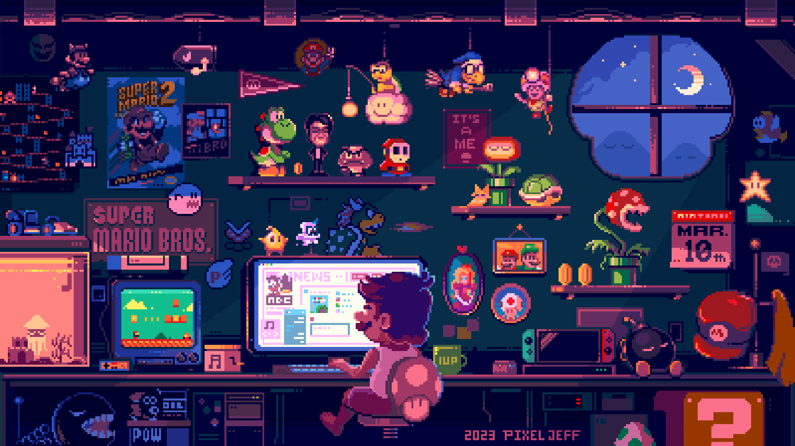

<h1 align="center">Hi 👋, I'm Johny</h1>
<h2 align="center"><b>Backend-focused Software Engineer | Architecture in Evolution</b></h2>

### 👨‍💻 About me

I'm a **4th-year Computer Engineering student** with a strong focus on **Backend Development, Software Design, and System Architecture**.

I enjoy designing systems that are **clean, scalable, and well-structured**, and I’m especially interested in the intersection of **backend engineering, research, and architecture**.

> Alongside my academic background, I’ve worked in real production environments, collaborating with teams and building backend systems for companies and individual clients.

I’m constantly learning, experimenting, and improving — driven by curiosity and a desire to build software that actually lasts.

### 🧠 What I focus on

- Research-driven development
- Clean code, scalability, and maintainability
- API design & architecture (REST, modular systems)
- Backend-first system design
- Open Source and developer tooling

---

### 🛠️ Experience in

<h3 align="center">Backend</h3>

  
  
  
  
  
  
  
  
  
  
  
  
  

<h3 align="center">Dev & Insfrastructure</h3>

  
  
  
  
  
  
  
  
  
  
  
  
  

<h3 align="center">Frontend</h3>

  
  
  
  
  
  
  
  
  

<h3 align="center">Databases</h3>

  
  
  
  
  

---

### 💼 Experience

- Worked as a **Backend / Software Developer** in **2 companies**
  - [Medialityc](https://github.com/medialityc)
  - [Avangenio](https://avangenio.com/)
- Built custom software solutions for individual clients

---

### 📚 Currently learning & improving

- Software Architecture & Design Patterns
- Backend scalability and performance
- Better system modeling and decision-making
- New Frameworks and automatizations with n8n

---

### 😁 Let’s build and learn together
Always open to meaningful backend roles, system design discussions, and open source collaboration.
You can reach me on <a href="https://www.linkedin.com/in/johny-antonio-pedraza-romero">LinkedIn</a>.

> _“Learning never stops — systems evolve, and so do we.”_
